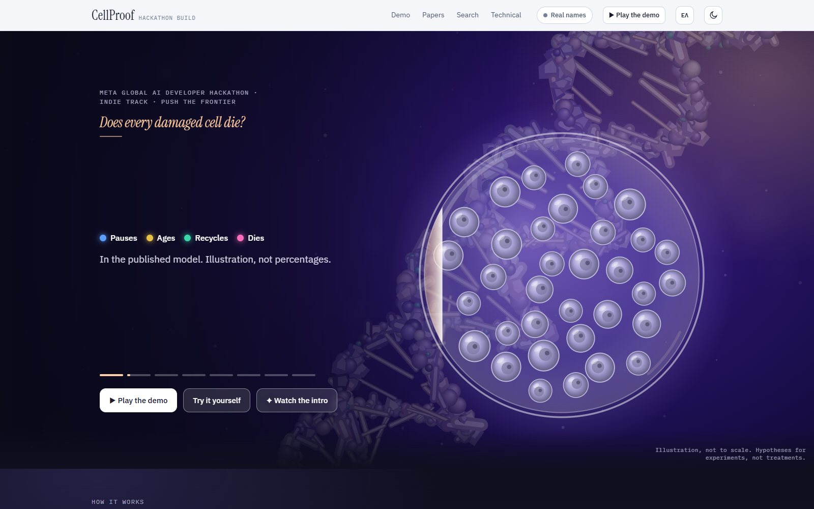
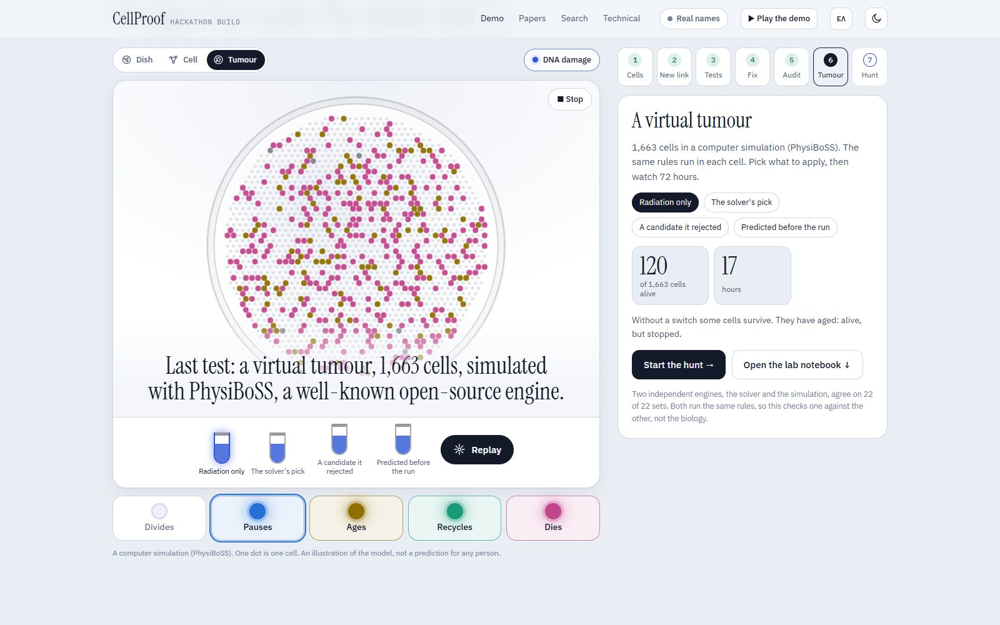
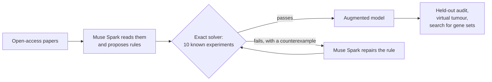

# CellProof

[](https://github.com/scoobydoobydrew/cellproof/actions/workflows/ci.yml)

**LLM-proposed rules, solver-verified: repairing a cell-signalling model under formal verification.**

Meta Global AI Developer Hackathon, Indie track, "Push the Frontier". A research prototype. It prioritises hypotheses for lab
testing and gives no medical advice.

> **What pre-existed and what was built this week.** Pre-existing: the published 30-node Boolean model of the DNA damage
> response (Gupta et al. 2023, CC BY), the open-access papers, the open-source solvers (clingo, mpbn, AEON, pyboolnet), the
> PhysiBoSS simulator with its MaBoSS engine, the open ChEMBL database, and the libraries listed in `THIRD_PARTY.md`. Built
> during the hackathon, in this repository only: everything in `src/`, `tests/`,
> `data/` (except the base model's rules, generated from its supplement by `src/cellproof/network/gupta2023.py`), `scripts/`
> and `docs/`.
>
> **The author's own earlier project.** On 24 October, before this hackathon began, the author built a different agent in a different repository, "Verified Knockout Agent": an LLM proposed gene knockouts on another published model
> (Remy et al. 2015, 35 nodes, 23 knockable genes) and an exact solver checked them. It did **not** read papers. CellProof is a new repository on a different model (Gupta et al. 2023) with new work: Muse Spark reads papers, the claims become
> rules, a repair loop, a held-out audit, a virtual tumour. The two share the idea that a model proposes and an exact solver decides. One note from that project (`lessons.md`) was committed to this repository on 29 October and removed on 30 October; it is still in the git history.

## In 30 seconds

- **What it is.** An agent in which Muse Spark reads papers and proposes rules for a published cell-signalling model, and an exact solver accepts or rejects each rule, returning a counterexample that Muse Spark uses to repair it.
- **Why it matters.** Applied without the solver, edits taken from papers break 7 of 10 known behaviours of the model; with the solver, none (`results/RESULTS.md`).
- **What it does not do.** It does not predict held-out outcomes better than the published model; the result is an automatic audit of where a model and the literature disagree. Failed checks are reported next to the passed ones.
- **Live demo.** [scoobydoobydrew.github.io/cellproof](https://scoobydoobydrew.github.io/cellproof/): the same page as `results/report.html`, hosted on GitHub Pages. The box for dropping your own PDF shows an example run there; reading a real PDF needs `cellproof serve` on your machine, with your own API key.
- **Try it.** Open `results/report.html`, or run `make verify` (no API call, no cost), or `docker compose run --rm verify`.
- **Video.** [The 3-minute walk-through](https://youtu.be/3CyR4baXoyg): what pre-existed and what was built this week, the demo, and `cellproof verify` replayed from the cached model outputs.

## Screenshots

From the page `results/report.html` (the live demo above). The middle frame is one moment of the 72-hour tumour simulation, not its end state.






## The idea

Boolean network models of cell signalling are powerful but incomplete: they miss mechanisms the literature already knows. A
language model can read papers and turn sentences into rules, but it cannot tell whether a rule breaks the model. An exact
solver can tell, but cannot read. CellProof joins them:

1. **Read.** Muse Spark reads each paper and returns mechanisms (`A activates / inhibits / is required by B`) with a quote.
   A quote that is not found verbatim in the paper is discarded.
2. **Ground.** Names are mapped to nodes through HGNC symbols and aliases. New nodes are added only if the evidence connects them
   to the network in both directions.
3. **Propose.** A fixed template turns each edge into a change of one rule.
4. **Verify.** An exact solver (complete fixed-point enumeration, attractor analysis) checks the edited network against ten
   known wild-type and mutant behaviours. A change that contradicts one comes back with a **counterexample**.
5. **Repair.** Muse Spark gets the claim, the evidence and the counterexample and proposes another rule. The solver checks it again;
   a repair that only restores the cases by making the new term inert is refused.
6. **Evaluate.** The augmented network is compared with the base network on held-out outcomes it never saw.



The model proposes; the solver decides. Every accepted or rejected rule is traceable to papers, quotes and a solver verdict:
`python -m cellproof.cli explain "CHK1|inhibits|Cdc25"`.

## Results

All numbers are produced by `make verify` and written to [`results/RESULTS.md`](results/RESULTS.md). Read the limits first:
[`docs/limitations.md`](docs/limitations.md).

**The interactive report is [`results/report.html`](results/report.html)** (open it in a browser; `python -m cellproof.cli report`
rebuilds it). It opens with an eight-beat header in plain words, in English or Greek (the **EN / ΕΛ** button), with no gene names, over a close-up of
DNA: radiation breaks DNA; not every damaged cell dies; the goal is a few genes to switch so that every cell does; new rules from papers keep changing
which combinations work; the number of combinations explodes (1,058 sets of one or two changes, over a million of five); the AI proposes and the solver
decides; a virtual tumour (a real simulation of 1,663 cells, replayed with and without one of the solver's candidates); and 9,896 public tumour samples
as one dot each, showing that every candidate relies on one gene (p53) and what share of samples have lost it. Straight after the header comes a
strip of six counts that count up as it scrolls into view (papers read, links proposed, known experiments, changes tried, virtual cells, candidates),
then the **demo**: a test bench in six clickable steps (a dish of cells, a missing link, ten known experiments, a fix, an audit, the virtual tumour) and a hunt
for every way to leave only death, with a *Play the demo* button that walks through all of it in about 70 seconds. After the demo come the **papers**: the 36 the AI found and read on its own, each drawn as a graph of what it says with the solver's verdict on every
link it can judge (three small animated cards say how to read the map: a dot is a gene, a line is a claim, a colour is the checker's verdict), and a second part for a PDF you hand it
(a paper it cannot reach), read on your computer by `make serve` (`docs/own_papers.md`);
then the **search
engine**: the solver's verdict on all 1,058 sets of one or two changes drawn on one board, for the model cell and for tumour profiles (the front
page shows the one where p53 is lost; the other four appear with *Real names* on; `docs/search_board.md`), and three short cards on what this is and is not. That is the whole front page. Everything technical (in English: the
interactive cell with all of its genes, the agent, every rule it judged, the evidence, the tissue, sequence and genotype studies and the limits) is
behind one button (*Technical* in the top bar) and opens in place; it starts with a map of where to look and a glossary in plain words, and each study reads as a heading and one plain
sentence, with its tables behind *Show the details*. The front page names no gene but p53 (the others are numbered, and the cell fates
keep plain words); the **Real names** button in the top bar shows the scientific names (the technical part always shows them). Every number on the page is computed when it is built, never typed in; the pictures are
illustration unless they say that they are the simulation or public counts (see `docs/limitations.md`). The headline numbers, each also in
`results/RESULTS.md`:

| | |
|---|---|
| Papers read by Muse Spark | 36 open-access papers, each read twice (molecule on molecule; DNA damage on molecule) |
| Claims extracted | 709, of which 708 have a quote found word for word in the paper |
| New genes found by a mechanical rule | ATR, CHK1, CHK2, DNA-PK |
| Rule edits from papers that contradict a known behaviour | 14 of 30 (47%), every edge with at least one paper |
| Known behaviours broken when edits are applied without the solver | 7 of 10 (every edge) and 8 of 10 (at least two papers); with the solver, 0 |
| Rejected edits repaired by Muse Spark and accepted by the solver | 6 of 9 (every edge), 3 of 4 (≥2 papers); Muse Wonder: 6 of 9 and 2 of 4 |
| One repair call, Spark vs Wonder | 39.7 s and $0.04 against 102.6 s and $0.19 (median of 3) |
| The search for gene sets that leave only death, solver alone | all 1,058 sets of up to two changes tried exactly in seconds, 11 minimal sets; sets of up to 5 changes would be 1,233,674 (projected time in the report) |
| The same search, AI alone (Muse Spark, no tools, minimal reasoning, 3 requests) | 13 of 17 distinct guesses leave only death (a random candidate: 21%), 4 of the 11 minimal sets found, none checked; see `docs/limitations.md` |
| Held-out audit: 23 claims, 10 scoreable | published model 3 correct, 5 wrong, 2 not expressible; augmented networks 4 correct, 6 wrong; a rule that ignores the perturbation 5 correct |
| Exact checker on 400-node chains | stable states in milliseconds, 13 s in all; random networks time out from 50 nodes |
| Tissue what-if: 1,663 irradiated cells in PhysiBoSS, 72 h (extension) | the simulation agrees with the exact solver on 22 of 22 sets: the 11 solver sets leave at most 12 cells alive (none in 7 of them) and reach 0 by 240 h, the 11 rejected sets of the same size leave at least 34; radiation alone leaves 107 cells, all senescent |
| Literature check of PTEN and RB loss (extension) | 24 open-access papers read in two waves under a rule fixed before reading (six per gene, then six more by the same rule, decided after the first results), 10 on topic, quotes checked by code: 4 agree with the model's direction, 5 contradict it and 1 shows no difference; where the gene itself was changed in the same cells, 1 agrees and 3 contradict (the one RB1 knockout gave radioresistance and less apoptosis); none reports apoptosis as the only fate |
| Start-aware and sequential analysis (extension) | exact reachability from a healthy irradiated cell: 2 of the 4 stable states can be reached (the tissue run reached the same 2); 3 more minimal sets than the solver finds (AMPK_MAPK KO + CHK1 KO, Cdc25 on, Sirt1 on), predicted before and leaving no cell alive in the tissue (3 of 3); no pair, no order of the five kinases of the brief (1,081) and no set of three knock-outs (14,586 orders) works only in a particular order, and one pair works only at once; the first validation against the tissue failed for 8 of 23 conditions, an amended one, added after seeing that, holds for 23 of 23 |
| The search engine's board (extension, `docs/search_board.md`) | The solver's verdict on all 1,058 sets of one or two changes: for the model cell 226 leave only death and 11 are minimal; with p53 lost, none of the 968 sets offered does; two profiles (hTERT, MDM2 high) keep the same 11, one (WIP1 high) keeps a different single set; a model statement, not about any person |
| Tumour genotypes as constraints on the model (extension) | 9,896 TCGA tumour samples from 32 studies (counts only): TP53 is lost in 14.2% (narrow rule) to 38.6% (broad rule) of them, and for none does any of the 11 sets leave only apoptosis; with TP53 intact each set works in 95% to 96.5% of the samples (80.4% for one); a model statement about genotype, not about any person |
| Solver targets and ChEMBL chemistry (extension) | 3 of the 11 sets are knock-outs (PTEN, RB, TUG1); PTEN has 5 activity records and none at 1 micromolar, and the 6 strong records of RB1 all read out its phosphorylation in cells; the 5 kinases named in the brief have 566 to 2,299 compounds at 1 micromolar, but knocking out any of them alone leaves all four end states |
| Extraction accuracy (M4) | TBD: needs 50 claims labelled by a person |

**What the audit says.** The augmented networks do not predict the held-out outcomes better than the published model: none of
its 8 verdicts changed, and a rule that ignores the perturbation scores higher than any network. In 4 of the 8 claims the
published model can address (p53 knocked out, and WEE1 inhibited in a p53-null line) it has no stable state at all: the
network oscillates, nothing is "present" under the frozen scoring rule, and those verdicts, marked `*` in
`results/m1_heldout.md`, are artifacts and not predictions. On the other 4 it gets 2 right, the same as ignoring the
perturbation. The annotation was added after the first scoring run and changes no verdict. So the useful result is the audit
itself, an automatic comparison of a published model with the literature that also shows where the model gives no answer,
and the solver loop that keeps added mechanisms from breaking what the model already gets right. Ten scoreable claims
cannot show an improvement either way.

**Taking the answers downstream (extension, `docs/downstream_notes.md`).** The solver's sets were run in a virtual tissue (PhysiBoSS,
an existing simulator of many cells) and turned into a list of targets with measured chemistry from ChEMBL. The tissue is a
second, independent check of the solver, not a prediction about any patient: no signals between cells, no drug, no dose, no
division, rates that are choices. The chemistry step ends where it does for a reason that is itself a result: where the solver
points there is no chemistry (PTEN, RB1), and where the chemistry is (ATR, CHK1, WEE1, DNA-PK) this model points only through one pair found later by the start-aware analysis (CHK1 knocked out with AMPK_MAPK, a node that merges two entities). No
drug-affinity model was run: MSF-DTA has no public code that could be found, and its inputs would be missing for these targets.
Every answer also depends on p53: with p53 knocked out, none of the 11 sets leaves only apoptosis (`results/RESULTS.md`), and on 9,896 public tumour samples none of those with TP53 lost has a set that works. Two later studies took ideas from papers the project owner supplied: an exact start-aware and sequential analysis (`docs/sequential_protocol.md`, after Mandon et al. 2019), which finds three more sets that the tissue run confirmed and no sequence-only set, and the genotype study (`docs/genotype_protocol.md`, after Montagud et al. 2022).

## Reproduce

```bash
python -m venv .venv && .venv/bin/pip install -e .[dev]      # Python 3.11+
docker compose run --rm verify   # the same without installing anything: pinned dependencies, cached model outputs, no key
make test      # unit tests, no network
make verify    # rebuilds every table from cached model outputs; no API call, no cost; a cache miss is an error
make extract   # the only target that spends money: calls the Meta Model API for requests not yet in cache/
make label     # local page for the two reading tasks only a person can do (M4 labels, D4 quote checks)
make sequences # exact start-aware and sequence search (tens of minutes on several cores, no network); `make verify` only reads its result
make serve     # the report from this computer, with a drop zone for your own PDFs (needs MODEL_API_KEY; a paper costs a few cents after you confirm it)
make ingest PDF=paper.pdf ARGS=--dry-run   # read a PDF of your own from the command line; without ARGS it is sent to Muse Spark
make board     # the search engine's data: the solver's verdict on all 1,058 sets for the model cell and five tumour profiles (about 20 seconds); `make verify` only reads it
```

The tissue what-if needs PhysiBoSS, which `make verify` does not: `bash scripts/physiboss_setup.sh` builds it once (WSL or Linux,
g++ and make only), `python -m cellproof.cli tissue` re-runs the conditions, `python -m cellproof.cli compounds` asks ChEMBL again,
`python -m cellproof.cli genotypes --fetch` reads the TCGA tumour alterations from cBioPortal again (without `--fetch` it only recomputes from the committed counts).

`.env` holds `MODEL_API_KEY` (never committed; see `.env.example`). Standard model IDs only, never `-contributor`.

## Meta models

| Model | Where | Role |
|---|---|---|
| Muse Spark (`muse-spark-1.3`, Standard) | `src/cellproof/meta_client.py`, `extract/`, `verify/repair.py`, `ingest/` | The core of the pipeline: reads papers, proposes rules, repairs rejected ones, and is the "AI alone" baseline of the search. Every call is cached on disk, so `make verify` makes none. |
| Muse Wonder (`muse-wonder-1.0`) | `cli.py` (`augment`, the ablation M5), through `verify/repair.py` | The same repair task, to compare accuracy, cost and latency with Muse Spark (table above). |
| MMS-TTS (`facebook/mms-tts-eng`, open weights, CC-BY-NC 4.0) | tried, **not in the repository** | Meta's open-source text-to-speech, tried for a first draft of the voice-over of the opening (installed locally with PyTorch and Transformers, run offline). It was dropped: the opening is read aloud by the browser's voice instead (below). Not used by the pipeline or the page, no fine-tuning of any model was done. |

Not used: SAM 3.1, Muse Image, Muse Voice Transcribe, Muse Spark Open, Muse Glimmer. The page (`results/report.html`) makes no model call: it only reads results stored
when it is built. The one thing it takes from the machine is a **browser feature, not a model**: the opening (button *Watch the intro*) is read aloud by the browser's own speech
synthesis (on Microsoft Edge, its natural voices, in English or Greek; the voice depends on the browser, and without one the words just stay on screen). Standard model IDs only, never `-contributor`.

## Layout

```
src/cellproof/
  meta_client.py     Meta Model API (Responses API) with an on-disk cache keyed by model, prompt and parameters
  corpus/            Europe PMC selection and download (open access, Creative Commons only)
  extract/           Muse Spark structured extraction, quote check, outcome filter
  formalize/         grounding (HGNC), edges, template edits, augmentation driver
  verify/            exact checker, acceptance rules, Muse Spark repair
  network/           bnet reader, base network from its supplement, phenotype definitions, Boolean logic
  analysis/          fixed points and attractors, scaling measurements, start-aware and sequential analysis (exact reachability with AEON)
  eval/              held-out set, scoring, report, the click page for M4 and D4
  ingest/            your own PDFs: text, guard (never an audit paper), claims, solver verdicts, one graph per paper (`docs/own_papers.md`)
  serve.py           the local server behind the page's drop zone: local only, one paper at a time
  tissue/            PhysiBoSS tissue what-if: network translation, settings, WSL runner, output parser, experiments
  targets/           the solver's sets as targets (HGNC) and ChEMBL measured chemistry
  genotype/          tumour genotypes (TCGA through cBioPortal) as constraints on the model: counts of signatures, what the model says for each
                     (the search board of `analysis/search_board.py` is the solver's verdict on every set of one or two changes, per profile)
Dockerfile, compose.yaml   `docker compose run --rm verify` / `test`
.github/workflows/ci.yml   unit tests and `cellproof verify` on every push
eval/                where the evaluation is: its protocol, metrics and results (an index; the code is in `src/cellproof/eval/`)
data/                base network, verification cases, held-out set (frozen), extractions, models, HGNC cache
docs/                protocol of the held-out set, limitations, notes on the Meta API and the extraction
LICENSE              MIT
```

## Honesty notes

- The held-out set (23 claims, 10 scoreable) was frozen before any network was scored; its history is in
  `docs/heldout_protocol.md`. A human has not yet checked that each quote supports its claim, so M1 is provisional.
- Extraction accuracy (M4) needs 50 claims labelled by a person (`data/labels/m4_sample.csv`) and is TBD until then. `make label`
  opens a page where each click is saved; nothing in it is pre-filled and no model is called.
- The tissue and chemistry steps are an extension and a second check of the solver. They say nothing about drugs, patients,
  efficacy, safety or secondary cancers (`docs/downstream_notes.md`), and a Boolean model of one published network decides
  every set they start from.
- The sequence and genotype studies each have a protocol committed before their results (`docs/sequential_protocol.md`, `docs/genotype_protocol.md`). The
  first validation of the sequence analysis against the tissue failed for 8 of 23 conditions; an amended one, written after seeing that and labelled so,
  holds, and is tested out of sample. Both are reported. The genotype study is about how the model's answers depend on genotype, counted on public tumour
  data with a crude rule; it says nothing about any person.
- Third-party code and data are declared in `THIRD_PARTY.md`; paper texts are downloaded, not redistributed.

## License

MIT, see `LICENSE`. It covers this repository's own code, documents and screenshots. Third-party code, models and data keep their own licenses
(`THIRD_PARTY.md`); the base model of the DNA damage response is CC BY (Gupta et al. 2023).
